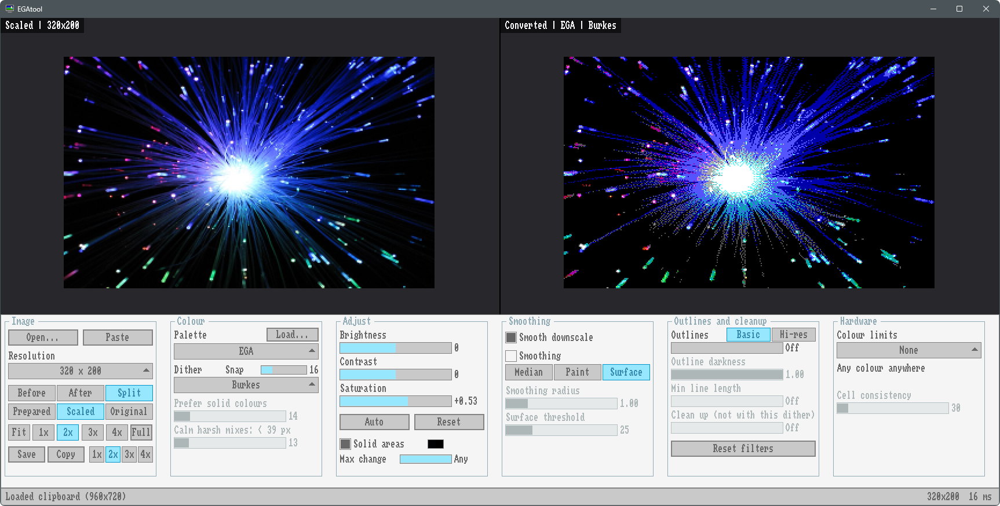
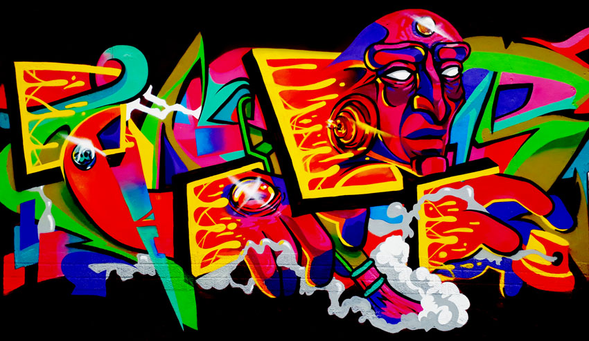
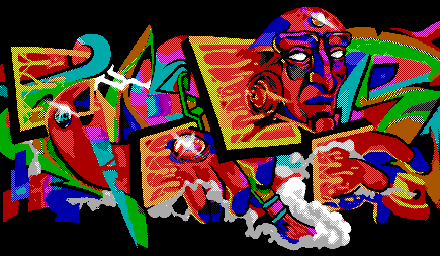
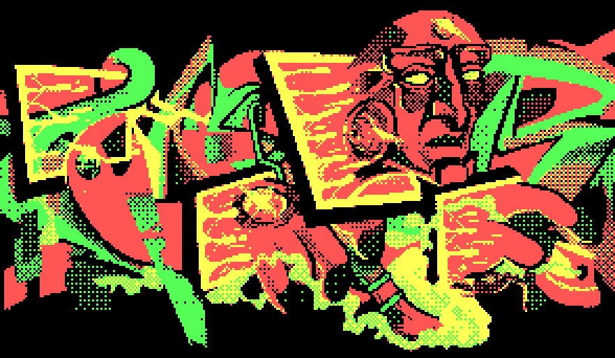
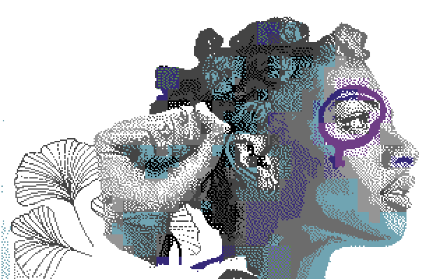
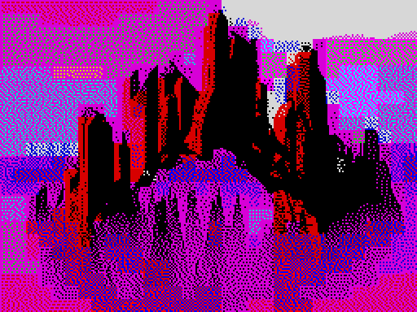
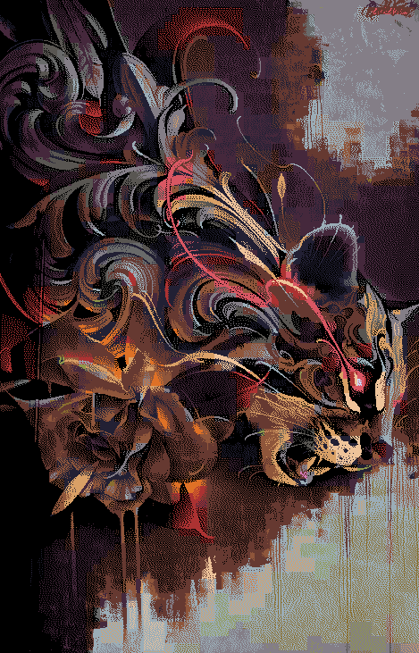

# EGAtool

Converts images to classic EGA and other limited palette styles with various 
dithering methods.

Acknowledgement: Program concept and checkerboard algorithm from Pic2EGA tool 
of DOS-AID Soft, https://dosaidsoft.com/wp/official-software/. Many thanks to 
the author.

## Features and screenshots

The program can process and dither any image, but it works best with paintings
or other images with flat surfaces of colour. Photographs mostly do not give
results as good.

(Note: if you use AI, a model can make a painting-style image based on a photo
or sketch.)

 

  Example image <a href="https://www.flickr.com/photos/armydre2008/2553927855/">Orb of Light</a>
  by <a href="https://www.flickr.com/photos/armydre2008/">frankieleon</a>,
  licensed under <a href="https://creativecommons.org/licenses/by/2.0/">CC BY 2.0</a>,
  shown converted to EGA.

Base features include scaling the image to a common 80s/90s size, and producing
a limited-palette dithered output approximating era styles.

As an example, using this image of a graffiti piece as a starting point,
background removed in an image editing program:

 

  <a href="https://commons.wikimedia.org/wiki/File:Canvasman.jpg">Canvasman.jpg</a>
  by <a href="https://commons.wikimedia.org/wiki/User:Streetanfo">Streetanfo</a>,
  licensed under <a href="https://creativecommons.org/licenses/by-sa/4.0">CC BY-SA 4.0</a>.
  Background removed.

The image can be rendered with classic checkerboard process, in EGA colours:

 

  Based on <a href="https://commons.wikimedia.org/wiki/File:Canvasman.jpg">Canvasman.jpg</a>
  by <a href="https://commons.wikimedia.org/wiki/User:Streetanfo">Streetanfo</a>,
  licensed under <a href="https://creativecommons.org/licenses/by-sa/4.0">CC BY-SA 4.0</a>.
  Background removed, converted with EGAtool.

Saved with 2x pixel size to better see the detail. On phone screen you may need
to zoom in to see the dithering.

Or with ordered dithering in CGA colours, using solid colour detection:

 

  Based on <a href="https://commons.wikimedia.org/wiki/File:Canvasman.jpg">Canvasman.jpg</a>
  by <a href="https://commons.wikimedia.org/wiki/User:Streetanfo">Streetanfo</a>,
  licensed under <a href="https://creativecommons.org/licenses/by-sa/4.0">CC BY-SA 4.0</a>.
  Background removed, converted with EGAtool.

(Saved with 3x pixel size.)

Image can be coloured according to constraints 8bit era platforms had. Below
example conforms to palette and limitations of the C64 high resolution mode:
only 2 colours in each 8x8 pixel cell. Burkes error diffusion. Saved in 2x pixel
size.

 

  Original image <a href="https://commons.wikimedia.org/wiki/File:Murala_Areatza_1.jpg">Murala Areatza 1.jpg</a>
  by <a href="https://commons.wikimedia.org/wiki/User:Wikimaribarre">Wikimaribarre</a>,
  licensed under <a href="https://creativecommons.org/licenses/by-sa/4.0">CC BY-SA 4.0</a>.
  Converted with EGAtool.

Image produced with palette, resolution and limits of ZX Spectrum:

 

  Original image <a href="https://commons.wikimedia.org/wiki/File:Erodedcity01_zupec.jpg">Erodedcity01 zupec.jpg</a>
  by <a href="https://commons.wikimedia.org/wiki/User:Nevit">Nevit</a>,
  licensed under <a href="https://creativecommons.org/licenses/by-sa/3.0">CC BY-SA 3.0</a>.
  Converted with EGAtool.

Limits and palettes can be mixed and used with resolutions not available on
original hardware. As an example, high-resolution conversion using C64 colouring
limits, but the DawnBringer 32 palette:

 

  Original image <a href="https://commons.wikimedia.org/wiki/File:Bublegum-cheste.jpg">Bublegum-cheste.jpg</a>
  by <a href="https://commons.wikimedia.org/wiki/User:Anitadr6">Anitadr6</a>,
  licensed under <a href="https://creativecommons.org/licenses/by-sa/4.0">CC BY-SA 4.0</a>.
  Cropped, converted with EGAtool.

Program provides many parameters for adjusting the process. Different types of
input images call for different parameters, as do different desired styles of
output. It is best to experiment with various source images to find most usable
combinations.

## Reference

### GUI controls

Source image can be loaded as a command line parameter, by pasting from clipboard,
by dragging a file on the window, or using the *Open...* button. 

On Linux clipboard works with `wl-clipboard` (Wayland) or `xclip` (X11) installed,
and the Open and Save dialogs need `zenity` or `kdialog` (otherwise they appear
as text in the terminal).

Source image is shown in left viewport, resulting image on right. By default, source
is in *prepared* display mode, with rescaling and effects applied before dithering
step. Buttons *Scaled* and *Original* allow display of the downscaled image with no 
processing, or the original image.

Buttons control magnifications in the viewports, *1x, 2x, 3x, 4x*. Same scale controls 
are available for saving images or copying to clipboard.

| Key            | Action                        |
|----------------|-------------------------------|
| Ctrl+O         | Open image                    |
| Ctrl+V         | Paste image                   |
| Ctrl+S         | Save output (PNG, BMP or TGA) |
| Ctrl+C         | Copy output                   |
| Tab            | Cycle Before / After / Split  |
| F, 1-4         | Fit, zoom 1x-4x (centred)     |
| Mouse wheel    | Zoom in/out one step          |
| Drag           | Pan                           |
| F11            | Fullscreen view, Esc to exit  |
| Arrow keys     | Move picture in viewports     |

Saved PNGs record the settings that made them, as a `egatool-cli`
command line in a `Comment` text chunk, e.g.

    egatool-cli -p ega -d sierra --snap 16 -s 640x350 --brightness 0 \
      --contrast 0 --saturation 0.00 -x 2 photo.jpg photo_ega_2x.png

Running it on the original image recreates the PNG exactly. To read PNG comment,
use `exiftool image.png`, `identify -verbose image.png` (ImageMagick), GIMP's
Image > Metadata, or Irfanview's Image > Information.

### Available Palettes

Palette used can be chosen from the dropdown list.

| Palette        | Colours | Notes                                               |
|----------------|---------|-----------------------------------------------------|
| EGA            | 16      | standard EGA/VGA text-mode colours               |
| VGA            | 256     | VGA BIOS default palette, from its 6-bit DAC levels (Checkerboard only with a hardware limit) |
| CGA            | 4       | mode 4 palette 1, high intensity: cyan, magenta, white |
| CGA warm       | 4       | mode 4 palette 0, high intensity: green, red, yellow |
| EGA 64         | 64      | every colour EGA can produce (4 levels per channel); games picked 16 of these at a time |
| Amstrad CPC    | 27      | CPC hardware palette (3 levels per channel)     |
| Commodore 64   | 16      | Pepto's measured palette                            |
| ZX Spectrum    | 15      | 7 colours at normal and bright intensity, plus black |
| MSX            | 15      | TMS9918: MSX1, ColecoVision, SG-1000, TI-99/4A      |
| Apple II hi-res | 6      | black, green, violet, orange, blue, white           |
| Game Boy       | 4       | original green LCD shades                       |
| NES            | 55      | common measured 2C02 palette, duplicates removed |
| DawnBringer 32 | 32      | a popular modern pixel-art palette by Richard Fhager |
| PICO-8         | 16      | the PICO-8 fantasy console                          |

*Load...* (or dropping a file) adds a JASC `.pal` palette to the list.

### Dither modes

- **Ordered** – a fixed 4×4 Bayer pattern. Even, regular cross-hatching that
  stays put when the picture changes.
- **Burkes** – error diffusion over two rows. Smooth and fairly clean, with
  less noise than the larger kernels. Often the most pleasant on photos.
- **Floyd-Steinberg** – the classic error diffusion, spreading each pixel's
  error to four neighbours.
- **Sierra** – error diffusion over three rows. Softer and more even than
  Floyd-Steinberg, at the cost of a little sharpness.
- **Stucki** – error diffusion over three rows with a wider spread. The
  smoothest gradients, but small details blur and can look grainy.
- **None** – every pixel becomes its nearest palette colour. Flat, posterised
  areas.
- **Checkerboard mode** - See below.

### Checkerboard mode

The classic Sierra/LucasArts EGA look: *Checkerboard* renders each pixel
as a solid colour or as a 50/50 checkerboard of two colours. 

*Light* (0..100) sets how a checkerboard's
colour is judged. At 0 (default) its two pixel values are averaged, which
matches how it looks up close with visible pixels. At 100 the emitted
light is averaged, which matches how a fine pattern looks from a distance
or with CRT-style blur: black + white then reads as light grey (about
188), not mid grey. Higher values follow the source's brightness more
closely at a distance but look darker and more muted up close; values in
between blend the two, with finer steps at the low end. Pairs that match
equally well are resolved towards contrast in the source's own hue, so
the contrasty choice is kept until the setting favours another pair.

*Prefer solid colours* (0..100, default 16) is how much closer a checkerboard
must come to the source colour before it replaces the nearest solid colour: each
step is a quarter of a level of RGB distance, so 0 uses a checkerboard whenever
it is closer at all. Palettes of up to 64 colours work (any size with a hardware
limit).

*Calm harsh mixes* steers small areas away from checkerboards of colours that
don't actually occur there: without it, anti-aliased lines and small details can
pick up black or white pixels. Pairs of colours that do occur within one output
pixel's area of the original are kept, so contrasty details survive. The setting
sets the largest area it applies to.

### Colour adjustments

*Brightness* and *Contrast* adjustments with sliders.

*Auto* sets Brightness and Contrast so the darkest and lightest 0.5% of
the image become black and white, like Photoshop's Auto Contrast.

*Saturation* works in the OKLab colour space: it changes colourfulness at
constant perceived lightness and hue, and colours that would leave the
sRGB range get the most saturation that fits instead of clipped channels.

### Solid areas (Not in checkerboard mode)

*Solid areas*  makes the largest flat areas of the
image, such as a sky or a painted wall, use available exact palette colours,
avoiding dithering patterns on large surfaces. Each area's colour moves onto the
palette colour that looks closest, judged in OKLab, and every other colour moves
along by an amount that depends on how similar it is: close colours almost as
much, colours more than about 64 levels away hardly at all. Areas must cover at
least 1% of the image; up to 8 are used.

*Max change* limits how far an area's colour may move. At the top, *Any*, a blue
sky can turn solid CGA red or magenta. Lower values keep only areas that are
already close to a palette colour.

The swatches next to the checkbox show each area's colour and the palette colour
it became, or *none found*. Before view in *prepared* mode shows the image with
colour substitutions.

### Snap (In error diffusion and ordered modes)

Error diffusion reproduces every colour on average, so a near-black navy sky
becomes black with a bright blue or grey dot every few pixels, and a near-white
wall gets grey specks. *Snap* (0..64, default 16) keeps colours within that many
levels of a palette colour solid in it, without dither dots.

### Hardware limits

Many 8 bit platforms limit how many colours a small part of the screen may use.
*Colour limits* applies those rules:

| Limit | Rule | Picks |
|---|---|---|
| ZX Spectrum | 2 colours per 8x8 cell, both bright or both normal | ZX Spectrum, 256x192 |
| C64 hi-res | 2 colours per 8x8 cell | Commodore 64, 320x200 |
| C64 multicolour | double-wide pixels; 3 colours per 4x8 cell plus 1 background for the whole screen | Commodore 64, 320x200 |
| MSX | 2 colours per 8x1 line | MSX, 256x192 |
| NES | each 16x16 area uses 1 of 4 palettes of 3 colours, plus 1 shared background | NES, 256x240 |

Choosing a limit also picks the machine's palette and screen size (the
size stays when the resolution is *Original*); both can be changed
afterwards, so ahistoric mixes (C64 cells with the EGA
palette, Spectrum rules at 640x350) work. Spectrum's bright rule
applies only to palettes built like the Spectrum's.

Holding Shift while choosing a limit skips automatic changing of resolution and palette.

Colours are chosen with following process:

- **Global choices first**: the background colour shared by every cell
  (C64 multicolour, NES) is the common colour that leaves the cells best
  off; NES's 4 palettes are grouped from the colours each area would
  like best, then refined.
- **Per cell**, every allowed set of colours (every pair, for 2-colour
  cells with up to 16-colour palettes) is scored by how well dithering
  between them can match the cell, counting brightness errors double:
  shapes stay readable even when the hue has to give.
- **Cell consistency** (0..300, default 30): a cell pays for colours its
  neighbours don't use, and may take a neighbour's colours outright, so
  flat areas and gradients don't break into blocks. 0 fits each cell
  alone; above 100, large areas share colours at the cost of some hue.
- **Drawing** dithers each pixel with its own cell's colours only.

With a limit chosen, *Calm harsh mixes* and *Clean up* don't apply, and
Checkerboard mode works with palettes of any size (the pairs come from each
cell). 

### Filters

Pre-processing that helps with photos and busy images. The *Prepared*
Before view shows the image after these filters and the colour
adjustments, i.e. what the converter actually sees.

- **Smooth downscale** – average source pixels when shrinking instead of
  picking one (nearest neighbour). On by default.
- **Smoothing** – *Median* removes small details; *Paint* (Kuwahara)
  flattens areas into solid patches while keeping edges sharp; *Surface*
  (like Photoshop's Surface Blur) averages each pixel only with nearby
  pixels of similar colour, so noise and shading within a surface are
  smoothed while thin lines and small details of a different colour keep
  their colour and width. *Surface threshold* is the colour difference
  (in levels) still treated as the same surface: 
- **Outlines** – darkens pixels along strong edges.
  The setting is the colour contrast an edge needs: 1 only takes near
  black/white boundaries, 100 takes almost any. Two modes:
  - *Basic* finds edges in the target-size image and inks their darker
    side. 
  - *Hi-res* runs Canny edge detection on the original image (reduced to at
    most 4x the target size), then scales the line mask down. 
    
  *Min line length* drops outline pieces shorter than N pixels.
- **Clean up regions under N** – after conversion, removes specks: areas
  of one colour (or one checkerboard pattern) smaller than N pixels that
  sit inside a single surrounding surface (70% or more of their border)
  take that surface's colour. Only for checkerboard and None
  modes without hardware limits.

## CLI

    egatool-cli [options] input output
      -p, --palette ega|vga|cga|cga-warm|ega64|cpc|c64|spectrum|msx|
                    apple2|gameboy|nes|db32|pico8|FILE.pal
      -d, --dither  checker|ordered|burkes|floyd|sierra|stucki|none
          --prefer-solid N checker: how much closer a checkerboard must come
                           than the nearest solid colour, 0..100 (default 16;
                           -b N from earlier versions is read as N / 25)
          --light-mix N    checker: judge checkerboards by pixel values (0,
                           default) or emitted light (100), or in between
          --harsh-mix N    checker: calm harsh colour pairs in areas up to a
                           size set by N, 0..100 (default 10, 100 = everywhere,
                           0 = original behaviour)
      -s, --size WxH       resize first (area average), e.g. 320x200,
                           or a percentage of the image's size, e.g. 50%
          --nearest        resize with nearest neighbour instead
          --snap N         ordered/diffusion: keep colours within N levels
                           of a palette colour solid, 0..64 (default 16)
          --auto-contrast  set brightness/contrast so the darkest and
                           lightest 0.5% become black and white
          --calibrate      not checker: make the largest flat areas exact
                           palette colours (see Solid areas)
          --calibrate-max N
                           calibrate: skip areas whose colour would change
                           by more than N levels (default any)
          --limit NAME     spectrum|c64|c64-multi|msx|nes: hardware colour
                           limits per cell (see Hardware limits)
          --consistency N  limits: how strongly neighbouring cells keep the
                           same colours, 0..300 (default 30)
          --brightness N   -128..127
          --contrast N     -127..127 (below 0: softer, towards mid grey)
          --saturation F   -1..1.5
          --smooth NAME    none, median, kuwahara or surface
          --radius F       smoothing radius in output pixels, 0.25..4 (default 1)
          --threshold N    surface smoothing threshold, 1..100 (default 25)
          --outline N      outline sensitivity 1..100 (default off)
          --outline-mode M basic or hires (default basic)
          --outline-dark F outline darkness 0..1 (default 1)
          --outline-min N  drop outline pieces shorter than N pixels
          --min-region N   clean up regions under N pixels (checker/none,
                           not with --limit)
      -x, --scale N        save enlarged N times (1..8, pixel-exact)
      -v, --verbose        print timing and the saved settings
          --version        print the version

## Code Layout

- `src/engine.[ch]` – palettes, adjustments, resizing and dithering on RGBA
  buffers; no dependencies
- `src/limits.c` – hardware colour limits (per-cell colour rules)
- `src/filters.c` – area resize, smoothing and outline pre-processing
- `src/imageio.[ch]` – load/save via stb_image
- `src/clipboard.[ch]` – Win32 clipboard, or wl-clipboard/xclip on Linux
- `src/recipe.[ch]` – the settings as a CLI command line, saved in PNGs
- `src/gui.c` – raylib/raygui front end, converting on a worker thread
- `src/thread.[ch]` – pthreads or Win32 threads for the worker
- `src/cli.c` – command line front end

## License

EGAtool is licensed under the [zlib licence](LICENSE). The libraries and
font in `external/` and the example images in `img/` keep their own
licences, listed below and under each image.

## External components

- [raylib](https://www.raylib.com/) by Ramon Santamaria – window, graphics
  and input for the GUI. zlib/libpng licence. Not included; see *Building*.
- [raygui](https://github.com/raysan5/raygui) 5.0 by Ramon Santamaria – GUI
  controls. zlib/libpng licence.
- [tinyfiledialogs](https://sourceforge.net/projects/tinyfiledialogs/) 2.9.3
  by Guillaume Vareille – Open and Save dialogs. zlib licence.
- [stb_image](https://github.com/nothings/stb) 2.30 and stb_image_write
  1.16 by Sean Barrett – image loading and saving. Public domain or MIT,
  at your choice.
- GUI font is "Amiga Topaz" by Patrick H. Lauke, from FontStruct
  (https://fontstruct.com/fontstructions/show/675155), licensed under
  Creative Commons Attribution 3.0; the font file, licence and readme are
  in `external/amiga-topaz/`, embedded via `src/topaz_font.h`.

The library files in `external/` are unmodified and keep their licence
notices.

## Building

Needs a C99 compiler and [raylib](https://www.raylib.com/) 6.0 or newer.
Everything else is vendored in `external/`.

    make              # build/linux/egatool, build/linux/egatool-cli
    make win          # build/win/egatool.exe, build/win/egatool-cli.exe (MinGW cross build)
    make all-targets  # both

On Linux, raylib is found with `pkg-config`, or else in `/usr/local`.
Elsewhere, pass the paths:

    make RAYLIB_CFLAGS=-I/opt/raylib/include RAYLIB_LIBS="-L/opt/raylib/lib -lraylib"

For Windows, point `RAYLIB_WIN` at an unpacked raylib MinGW release
(the folder containing `include/` and `lib/`):

    make win RAYLIB_WIN=~/raylib-6.0_win64_mingw-w64

On Windows, the easiest way is the same cross build in WSL: install the
MinGW compiler there (`sudo apt install gcc-mingw-w64-x86-64` on Debian or
Ubuntu) and run `make win`.

The Windows executables are statically linked and need no DLLs.
The command-line tool doesn't use raylib.
